# Arduino 및 ESP8266 기반 IoT 온습도 모니터링 시스템

## 프로젝트 개요

Arduino Uno와 DHT22 센서를 이용하여 실내 온도와 습도를 측정하고,
ESP8266을 통해 웹페이지에서 측정값을 실시간으로 확인하는 IoT 시스템 개발 프로젝트입니다.

웹페이지에서 LED 밝기를 조절하는 기능도 구현할 예정입니다.

사용 언어: C++, HTML, CSS, JavaScript (예정)

진행 기간: 2026.11.09 ~ 진행 중

---

## 온습도 센서 및 LED 제어 기능

### 1. 프로젝트 개발 환경 및 초기 구성

#### 1.1. 프로젝트 생성 및 개발 환경 설정

- VS Code에서 Arduino의 코드 작성, 컴파일 및 업로드를 진행하기 위해 PlatformIO IDE 확장 프로그램을 설치.

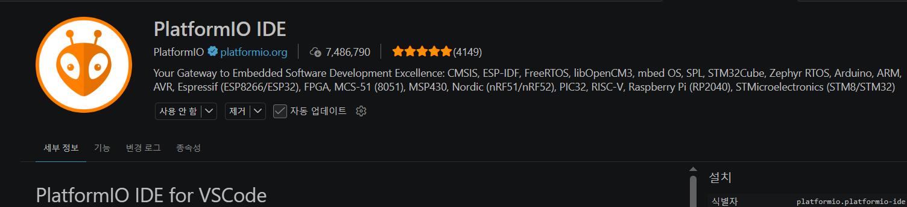


- PlatformIO의 Project Wizard에서 개발 보드를 Arduino Uno로 선택하고, 프레임워크를 Arduino로 설정하여 프로젝트를 생성.

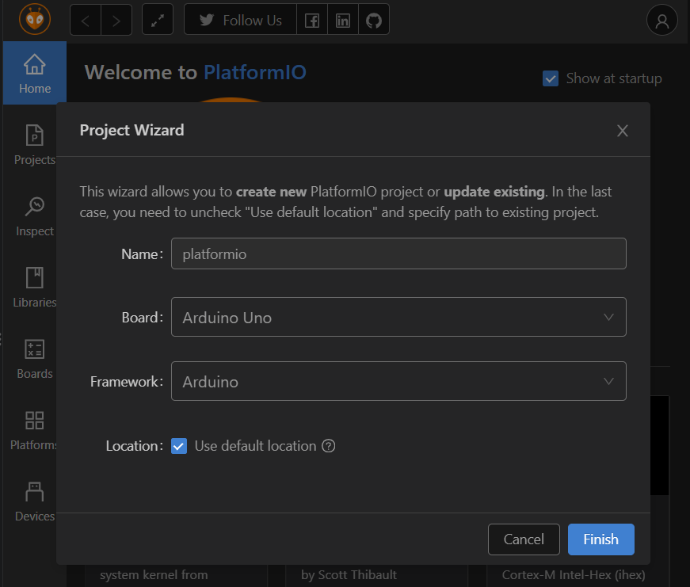


- DHT22 센서의 온도 및 습도 데이터를 읽기 위해 Adafruit의 DHT sensor library를 설치.

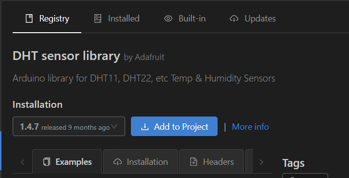


- platformio.ini에서 DHT sensor library의 등록 상태를 확인하고, Arduino Uno의 시리얼 데이터를 수신하기 위해 통신 속도(monitor_speed)를 9600bps로 설정.
```ini
[env:uno]
platform = atmelavr
board = uno
framework = arduino
lib_deps = adafruit/DHT sensor library@^1.4.7
monitor_speed = 9600
```
---

### 2. 하드웨어 회로 구성 및 센서 연결

#### 2.1. Arduino Uno와 DHT22 센서 연결

- Arduino Uno와 DHT22 센서를 연결하여 온도 및 습도 측정을 위한 회로를 구성.

  - VCC → Arduino Uno 5V
  - DATA → Arduino Uno D2
  - NC → 연결하지 않음
  - GND → Arduino Uno GND
  - 풀업 저항(10kΩ) → VCC와 DATA 사이 연결

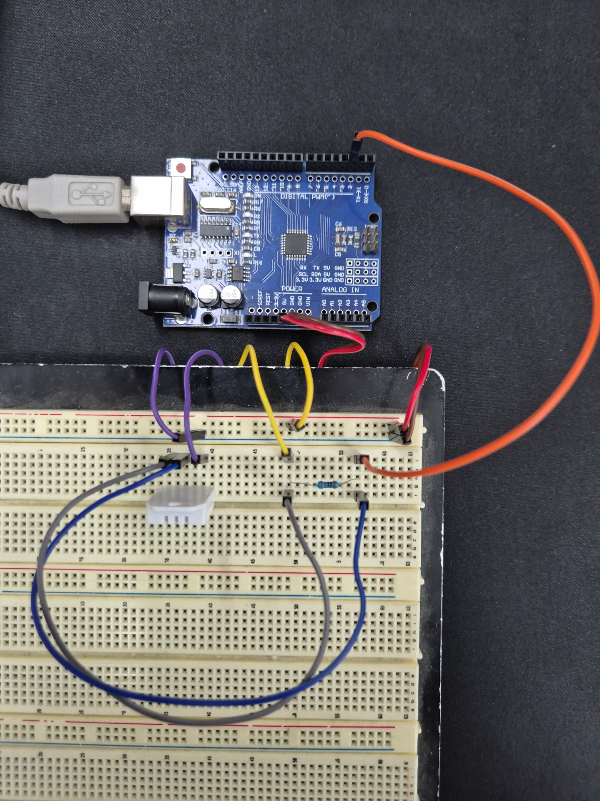

---

### 3. Arduino 센서 데이터 측정

#### 3.1. DHT22 온도 및 습도 측정 코드

- 라이브러리 추가, D2 핀 지정, DHT22 객체 및 측정 시간 변수 선언
```cpp
#include <Arduino.h>
#include <DHT.h>

const int DHT22_PIN = 2;
DHT dht(DHT22_PIN, DHT22);
unsigned long time_a = 0;
```

- 시리얼 통신 속도 설정 및 센서 초기화
```cpp
void setup() {
  Serial.begin(9600);
  dht.begin();
}
```

- millis 함수를 활용한 DHT22 측정 주기 설정
```cpp
if (millis() - time_a >= 2000) {
  time_a = millis();
```

- 센서 데이터 읽기, isnan() 오류 검사, 실패 시 처리
```cpp
    // 섭씨 온도 측정 후 float 값 반환 
  float temp = dht.readTemperature();

  if (isnan(temp)) {
    Serial.println("온도 측정 실패");
    return;
  }

  // 상대습도 측정 후 float 값 반환 
  float hum = dht.readHumidity();

  if (isnan(hum)) {
    Serial.println("습도 측정 실패");
    return;
  }
```

- 시리얼 모니터 출력
```cpp
  // 결과 출력
  Serial.println(temp); // 온도 

  Serial.println(hum); // 습도
}
```

---

### 4. LED 제어 기능

#### 4.1. 시리얼 통신을 활용한 LED 밝기 제어


- Arduino Uno와 노란색 LED를 연결하여 PWM 신호를 통한 밝기 제어 회로를 구성.

  - LED 양극(A) → 124옴 저항을 거쳐 Arduino Uno D9
  - LED 음극(C) → Arduino Uno GND
  - 저항(124옴) → 62옴 저항 2개 직렬 연결

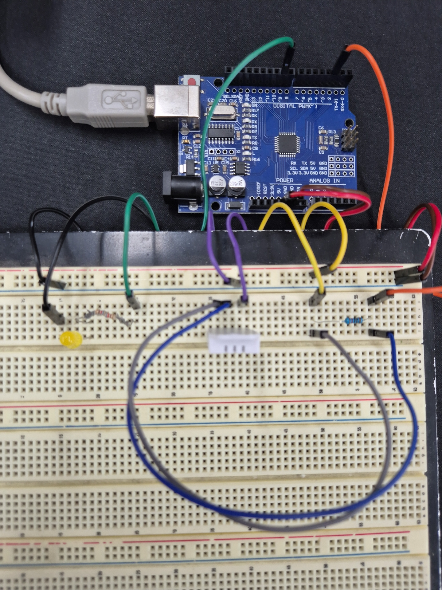

- LED 제어 핀 지정 및 PWM 출력 설정
```cpp
#include <Arduino.h>
#include <DHT.h>

const int LED_PIN = 9;
const int DHT22_PIN = 2;
DHT dht(DHT22_PIN, DHT22);
unsigned long time_a = 0;
int LED_light = 0;

void setup() {
  // put your setup code here, to run once:
  Serial.begin(9600);
  dht.begin();
  pinMode(LED_PIN, OUTPUT);
}
```

- 시리얼 데이터 수신 및 PWM 밝기 제어
```cpp
 // 수신 버퍼에 도착해 읽을 준비가 된 데이터의 바이트 수 반환
if (Serial.available() > 0) {
  if (Serial.peek() == '\n' || Serial.peek() == '\r') {
    Serial.read(); // 남아 있는 줄바꿈 문자 제거
  } else {
    LED_light = Serial.parseInt(); // 정수값 추출
    LED_light = constrain(LED_light, 0, 255); // 밝기 범위 제한
    analogWrite(LED_PIN, LED_light); // PWM 밝기 적용
    Serial.println(LED_light); // 적용된 밝기값 반환
  }
}
```

---

### 5. PL2303 USB UART Board (type A) 실험

#### 5.1. PL2303 USB 연결 및 장치 인식 확인

- PL2303 컴퓨터 USB 포트에 직접 연결 후 PWR 표시등 점등 확인

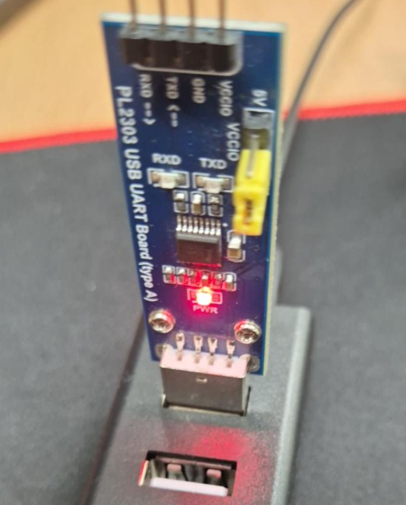

- 장치 관리자 실행, 포트(COM 및 LPT)에 Prolific USB-to-Serial Comm Port (COM숫자)가 있는지 확인

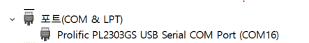

- Prolific USB-to-Serial Comm Port (COM숫자)을 더블클릭해서 장치 상태를 확인

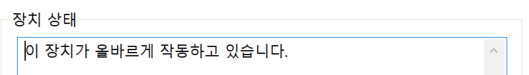

#### 5.2. PL2303 루프백 실험

- TXD와 RXD를 점퍼선으로 연결

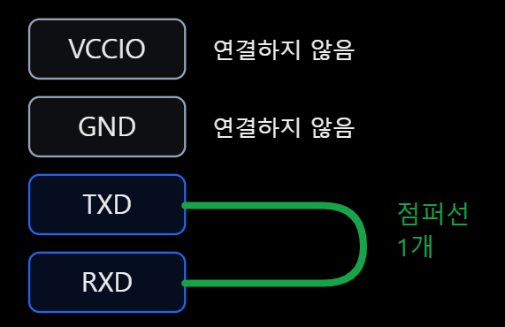

1. PL2303을 컴퓨터 USB에 다시 연결

2. VS Code의 PlatformIO(시리얼 모니터) 터미널에서 다음 명령어를 입력하여 해당 COM(숫자) 포트의 시리얼 모니터 실행

   ```powershell
   pio device monitor --port COM16 --baud 9600 
   ```

3. TXD와 RXD 점퍼선 연결 여부에 따른 문자열 표시 확인

   - 연결 시: `test01234` 입력 후 터미널에 동일한 문자열 표시

   - 미연결 시: 입력한 문자열이 터미널에 표시되지 않음

   아래는 점퍼선 연결 상태에서 `test01234`를 입력하여 확인한 실제 터미널 출력 결과

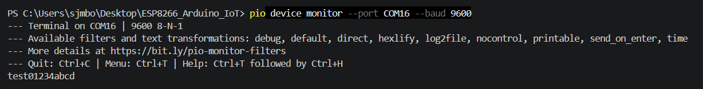

#### 5.3. PL2303과 ESP8266(ESP-01S) 연결 준비

- ESP8266(ESP-01S)의 핀 이름 설명 (아래 이미지 기준)

| 위치 | 왼쪽 핀 | 오른쪽 핀 |
|---|---|---|
| 1행 | RX | VCC |
| 2행 | GPIO0 | RST |
| 3행 | GPIO2 | CH_EN |
| 4행 | GND | TX |

- PL2303의 핀 이름 설명 (아래 이미지 기준)

| 위치 | 핀 |
|---|---|
| 1행 | VCCIO |
| 2행 | GND |
| 3행 | TXD <- |
| 4행 | RXD -> |

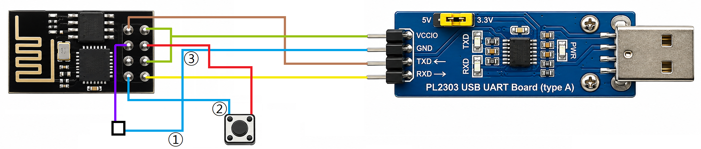

| 색상 | ESP8266 | PL2303 | 연결 조건 |
|---|---|---|---|
| - | GPIO2 | - | 연결하지 않음 |
| 🟤 | RX | TX | 상시 연결 |
| 🟡 | TX | RX | 상시 연결 |
| 🟣 | GPIO0 | - | 펌웨어 업로드 전 파란색 ①과 연결, 일반 실행 시 연결 해제 |
| 🔴 | RST | - | 리셋 버튼을 누를 때만 연결 |
| 🟢 | VCC | VCCIO | 상시 연결 |
| 🟢 | CH_EN | VCCIO | 상시 연결 |
| 🔵① | GND | - | 펌웨어 업로드 전 보라색 선과 연결, 일반 실행 시 연결 해제 |
| 🔵② | GND | - | 리셋 버튼을 누를 때만 연결 |
| 🔵③ | GND | GND | 상시 연결 |

※ 리셋 버튼은 ESP8266의 RST와 GND 사이에 연결하며, 버튼을 누를 때만 두 핀이 연결됩니다. GPIO0은 펌웨어 업로드 시 GND에 연결합니다.

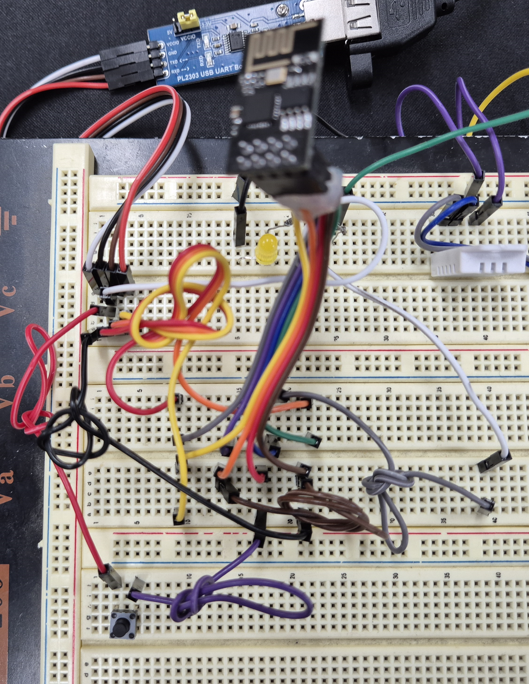


※ ESP8266(ESP-01S)의 핀 구성 및 펌웨어 업로드를 위한 배선 연결 방법은 아래 자료를 참고하여 구성하였습니다.

- [ESP8266(ESP-01, ESP-01S) 개요, 업로드하기](https://thinkanother.tistory.com/19)

---

### 6. ESP8266 ESP-01S 실험

#### 6.1. ESP8266 기본 동작 확인

- ESP8266(ESP-01S)의 GPIO2를 출력 핀으로 설정하고, 1초 간격으로 LOW/HIGH 상태를 반복하도록 제어 코드 적용

```cpp
#include <Arduino.h>

#define RELAY_PIN 2

// ESP8266 웹 서버 및 UART 기능은 향후 구현합니다.
void setup() {
  Serial.begin(9600);

  digitalWrite(RELAY_PIN, HIGH);
  pinMode(RELAY_PIN, OUTPUT);
}

void loop() {
  digitalWrite(RELAY_PIN, LOW);
  Serial.println("Relay ON");
  delay(1000);

  digitalWrite(RELAY_PIN, HIGH);
  Serial.println("Relay OFF");
  delay(1000);
}
```

- PlatformIO에서 `pio run -d esp8266` 명령어를 실행하여 펌웨어 빌드 성공 확인

- PL2303 USB-UART 모듈을 이용하여 ESP-01S에 펌웨어 업로드

- `pio run -d esp8266 -t upload --upload-port COM(숫자)` 명령어를 실행하여 업로드 및 데이터 검증 성공 확인

- ESP-01S를 릴레이 모듈에 장착하고 Arduino Uno의 5V와 GND를 이용하여 전원 공급

- 릴레이가 작동하지 않았으나, 시리얼 모니터로 ESP-01S의 동작과 파란색 LED가 1초 간격으로 점멸하는 것을 확인하였으며, 전원 공급 부족을 원인으로 추정

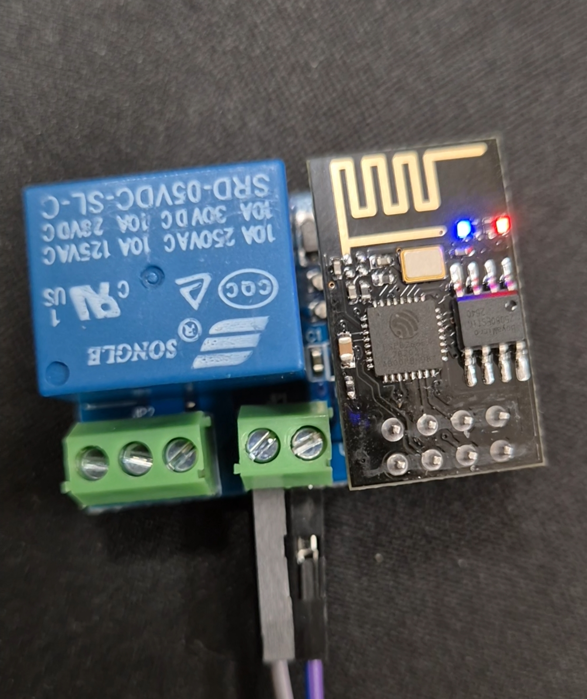

```
Relay ON
Relay OFF
Relay ON
Relay OFF
Relay ON
```

#### 6.2. Wi-Fi 통신 실험

ESP8266(ESP-01S)을 AP모드로 설정하여 자체 Wi-Fi 네트워크를 생성하고, HTTP 웹 서버를 통해 스마트폰에서 웹페이지에 접속하는 방식으로 실험을 진행하였다. 별도의 공유기 없이 ESP8266이 직접 Wi-Fi를 제공하며, 스마트폰에서 해당 네트워크에 연결한 후 ESP8266의 IP 주소로 접속하여 통신 동작을 확인하였다.

- ESP8266 Wi-Fi 및 HTTP 웹 서버 라이브러리 추가, Wi-Fi 이름과 비밀번호 설정

```cpp
#include <Arduino.h>
#include <ESP8266WiFi.h>
#include <ESP8266WebServer.h>

const char* ssid = "ESP8266_TEST";
const char* password = "********";
```

- HTTP 웹 서버 객체 생성 및 웹페이지 접속 시 표시할 HTML 문구 설정

```cpp
ESP8266WebServer server(80);

void handleRoot() {
  server.send(200, "text/html; charset=utf-8",
              "<h1>ESP8266 Wi-Fi 통신 성공</h1>"
              "<p>웹페이지 접속 확인</p>");
}
```

- 시리얼 통신 속도 설정 및 ESP8266 자체 Wi-Fi 네트워크 생성

```cpp
void setup() {
  Serial.begin(9600);

  WiFi.mode(WIFI_AP);
  WiFi.softAP(ssid, password);
```

- 웹페이지 접속 경로 설정 및 HTTP 웹 서버 시작

```cpp
  server.on("/", handleRoot);

  server.begin();
  Serial.println("Web server started");
}
```

- 웹 브라우저의 HTTP 요청 처리

```cpp
void loop() {
  server.handleClient();
}
```

- PlatformIO에서 `pio run -d esp8266` 명령어를 실행하여 펌웨어 빌드

- `pio run -d esp8266 -t upload --upload-port COM16` 명령어로 ESP-01S에 펌웨어 업로드

- 업로드 완료 후 GPIO0과 GND 연결선을 제거하고 리셋 버튼을 눌러 일반 실행 모드로 전환

- 스마트폰에서 `ESP8266_TEST` Wi-Fi 연결 및 IP 주소 `192.168.4.2` 할당 확인

- 스마트폰 웹 브라우저에서 `http://192.168.4.1/` 접속 후 HTML 문구 표시 확인

```text
ESP8266 Wi-Fi 통신 성공
웹페이지 접속 확인
```

※ Wi-Fi 비밀번호는 README.md 공개를 위해 마스킹 처리하였다.

---

## 웹 브라우저 구현

### 1. ??

#### 1.1. ?


---

## 프로젝트 디렉터리 및 빌드

이 저장소는 두 개의 독립적인 PlatformIO 프로젝트를 포함합니다.

- `arduino/`: 기존 Arduino Uno 소스, DHT22 센서, LED PWM 코드
- `esp8266/`: ESP-01S용 PlatformIO 기본 프로젝트 (웹 서버 및 UART 기능 미구현)
- `docs/troubleshooting.md`: 기존 문제 해결 기록
- `images/`: 기존 README와 문서에 사용된 이미지

VSCode에서 `arduino/` 또는 `esp8266/` 폴더를 각각 열어 빌드·업로드합니다.
또는 터미널에서 `pio run -d arduino`, `pio run -d esp8266` 명령을 사용합니다.

> 현재 Arduino 소스는 DHT22를 사용하며, 과제 명세서의 DHT11 및 UART 프로토콜은 아직 구현되지 않았습니다.
> ESP8266의 보드 설정(`esp01_1m`)은 실제 ESP-01S 모듈 사양을 확인하세요.
