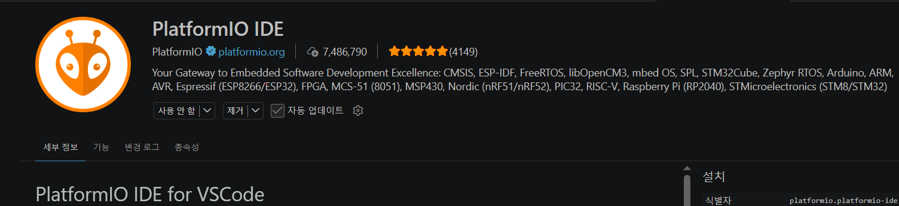
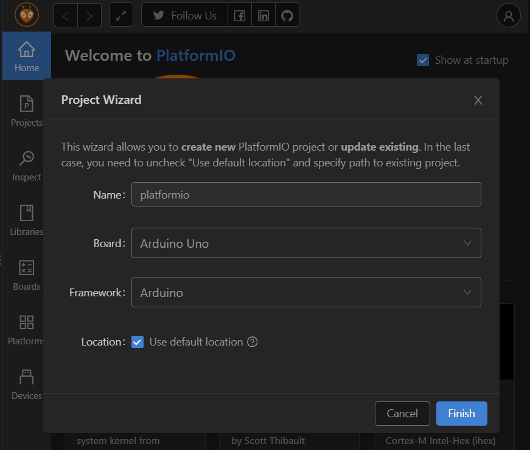
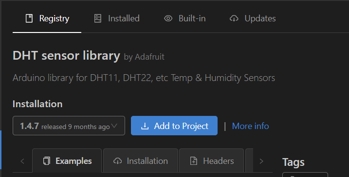
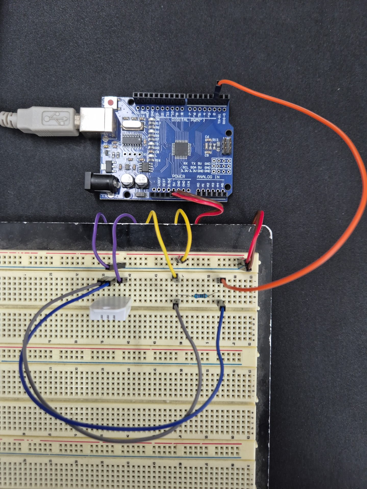
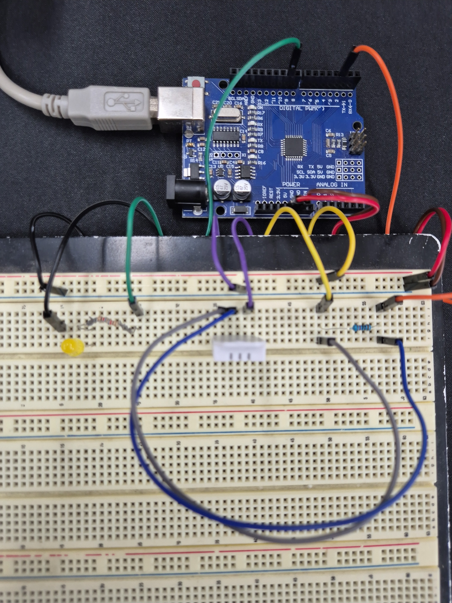

# Arduino 및 ESP8266 기반 IoT 온습도 모니터링 시스템

## 프로젝트 개요

Arduino Uno와 DHT22 센서를 이용하여 실내 온도와 습도를 측정하고,
ESP8266을 통해 웹페이지에서 측정값을 실시간으로 확인하는 IoT 시스템 개발 프로젝트입니다.

웹페이지에서 LED 밝기를 조절하는 기능도 구현할 예정입니다.

사용 언어: C++, HTML, CSS, JavaScript (예정)

진행 기간: 2026.11.09 ~ 진행 중

## 온습도센서 및 LED 제어 기능

### 1. 프로젝트 개발 환경 및 초기 구성

#### 1.1. 프로젝트 생성 및 개발 환경 설정

- VS Code에서 Arduino의 코드 작성, 컴파일 및 업로드를 진행하기 위해 PlatformIO IDE 확장 프로그램을 설치.



- PlatformIO의 Project Wizard에서 개발 보드를 Arduino Uno로 선택하고, 프레임워크를 Arduino로 설정하여 프로젝트를 생성.



- DHT22 센서의 온도 및 습도 데이터를 읽기 위해 Adafruit의 DHT sensor library를 설치.



- platformio.ini에서 DHT sensor library의 등록 상태를 확인하고, Arduino Uno의 시리얼 데이터를 수신하기 위해 통신 속도(monitor_speed)를 9600bps로 설정.
```ini
[env:uno]
platform = atmelavr
board = uno
framework = arduino
lib_deps = adafruit/DHT sensor library@^1.4.7
monitor_speed = 9600
```

### 2. 하드웨어 회로 구성 및 센서 연결

#### 2.1. Arduino Uno와 DHT22 센서 연결

- Arduino Uno와 DHT22 센서를 연결하여 온도 및 습도 측정을 위한 회로를 구성.

  - VCC → Arduino Uno 5V
  - DATA → Arduino Uno D2
  - NC → 연결하지 않음
  - GND → Arduino Uno GND
  - 풀업 저항(10kΩ) → VCC와 DATA 사이 연결




### 3. Arduino 센서 데이터 측정

#### 3.1. DHT22 온도 및 습도 측정 코드

- 라이브러리 추가, D2 핀 지정, DHT22 객체 및 측정 시간 변수 선언
```cpp
#include <Arduino.h>
#include <DHT.h>

const int DHT22_PIN = 2;
DHT dht(DHT22_PIN, DHT22);
unsigned long time_a = 0;
```

- 시리얼 통신 속도 설정 및 센서 초기화
```cpp
void setup() {
  Serial.begin(9600);
  dht.begin();
}
```

- millis 함수를 활용한 DHT22 측정 주기 설정
```cpp
if (millis() - time_a >= 2000) {
  time_a = millis();
```

- 센서 데이터 읽기, isnan() 오류 검사, 실패 시 처리
```cpp
    // 섭씨 온도 측정 후 float 값 반환 
  float temp = dht.readTemperature();

  if (isnan(temp)) {
    Serial.println("온도 측정 실패");
    return;
  }

  // 상대습도 측정 후 float 값 반환 
  float hum = dht.readHumidity();

  if (isnan(hum)) {
    Serial.println("습도 측정 실패");
    return;
  }
```

- 시리얼 모니터 출력
```cpp
  // 결과 출력
  Serial.println(temp); // 온도 

  Serial.println(hum); // 습도
}
```


### 4. LED 제어 기능

#### 4.1. 시리얼 통신을 활용한 LED 밝기 제어


- Arduino Uno와 노란색 LED를 연결하여 PWM 신호를 통한 밝기 제어 회로를 구성.

  - LED 양극(A) → 124옴 저항을 거쳐 Arduino Uno D9
  - LED 음극(C) → Arduino Uno GND
  - 저항(124옴) → 62옴 저항 2개 직렬 연결

- LED 제어 핀 지정 및 PWM 출력 설정
```cpp
#include <Arduino.h>
#include <DHT.h>

const int LED_PIN = 9;
const int DHT22_PIN = 2;
DHT dht(DHT22_PIN, DHT22);
unsigned long time_a = 0;
int LED_light = 0;

void setup() {
  // put your setup code here, to run once:
  Serial.begin(9600);
  dht.begin();
  pinMode(LED_PIN, OUTPUT);
}
```

- 시리얼 데이터 수신 및 PWM 밝기 제어
```cpp
 // 수신 버퍼에 도착해 읽을 준비가 된 데이터의 바이트 수 반환
if (Serial.available() > 0) {
  if (Serial.peek() == '\n' || Serial.peek() == '\r') {
    Serial.read(); // 남아 있는 줄바꿈 문자 제거
  } else {
    LED_light = Serial.parseInt(); // 정수값 추출
    LED_light = constrain(LED_light, 0, 255); // 밝기 범위 제한
    analogWrite(LED_PIN, LED_light); // PWM 밝기 적용
    Serial.println(LED_light); // 적용된 밝기값 반환
  }
}
```




### 5. ESP8266

#### 5.1. ?


## 웹 브라우저 구현

### 1. ??

#### 1.1. ?