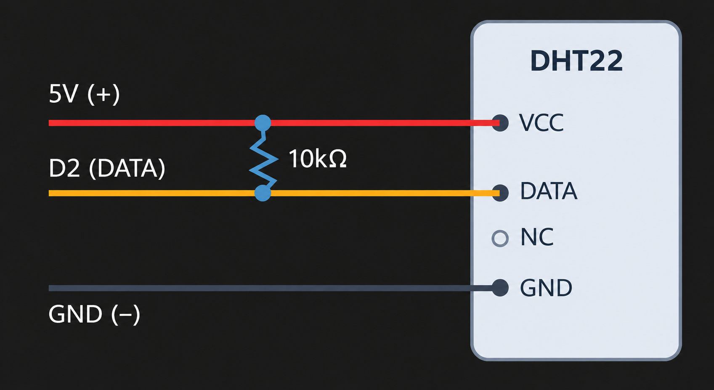
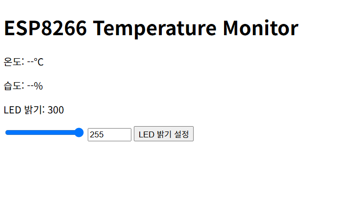

# Arduino 및 ESP8266 기반 IoT 온습도 모니터링 시스템 트러블슈팅

## 프로젝트 개요

Arduino Uno와 DHT22 센서를 이용하여 실내 온도와 습도를 측정하고, ESP8266을 통해 웹페이지에서 측정값을 실시간으로 확인하는 IoT 시스템 개발 프로젝트입니다.

웹페이지에서 LED 밝기를 조절하는 기능도 개발하고 있습니다.

- 사용 언어: C++, HTML, JavaScript / CSS(예정)
- 진행 기간: 2026.11.09 ~ 진행 중

---

## 온습도 센서 및 LED 제어 기능 챕터 트러블슈팅

### 1. DHT22 풀업 저항의 연결 방식 이해

**현상**
- DHT22 센서 회로 구성 과정에서 풀업 저항을 서로 다른 배선 사이에 연결하는 방법을 알지 못함.
- 풀업·풀다운 저항의 개념은 알고 있었으나 실제 회로에 적용하는 배선 방식에 대한 이해가 부족했음.

**환경**
- Arduino Uno
- DHT22 온습도 센서
- Wokwi 회로 시뮬레이터

**원인 가설**
- 전자회로 및 센서 배선 경험 부족으로 풀업 저항의 실제 연결 구조를 이해하지 못함.

**분석 과정**
- DHT22의 VCC, DATA, GND 핀 구성 확인.
- 풀업 저항의 연결 위치와 회로 구성 방식 검토.
- VCC와 DATA 사이에 저항을 연결하는 방식 학습.

**수정**
- 풀업 저항을 VCC와 DATA 사이에 연결하는 방식으로 배선 구조에 대한 이해 수정.
- 데이터 신호선의 논리 상태를 안정적으로 유지하기 위한 연결 원리 확인.



**검증**
- DHT22의 풀업 저항 연결 위치와 배선 원리를 확인함.
- 실제 회로에서 외부 풀업 저항을 추가한 동작 검증은 수행하지 않음.

**배운 점**
- 풀업 저항은 전원과 데이터 신호선 사이에 연결하여 신호의 기본 상태를 HIGH로 유지함.
- 회로 구성 시 부품 간 연결뿐 아니라 전원선과 신호선 사이의 연결 관계도 고려해야 함.

---

### 2. DHT22 센서 측정 코드의 `delay()` 사용으로 인한 다른 기능 실행 지연

**현상**
- DHT22 온습도 측정 코드를 먼저 구현한 후 LED 제어 기능을 추가하면서 실행 지연 문제가 발생함.
- 온습도 측정 간격을 위한 `delay()`가 다른 기능의 실행에도 영향을 줌.

기존 코드:

```cpp
// 센서 측정 간격
delay(2000);
```

**환경**
- Arduino Uno
- DHT22 온습도 센서
- LED 제어 기능
- VS Code 및 PlatformIO

**원인 가설**
- `delay()`가 지정된 시간 동안 프로그램의 다음 코드 실행을 지연시키기 때문으로 판단함.

**분석 과정**
- 기존 DHT22 온습도 측정 코드의 실행 구조 확인.
- `delay()`가 LED 제어 등 다른 기능의 실행에 미치는 영향 검토.
- `millis()`를 이용한 비차단 방식의 주기 제어 방법 학습.

**수정**
- 온습도 측정 간격에 사용하던 `delay()` 제거.
- `millis()`와 시간 저장 변수를 활용하여 약 2초 간격으로 온습도를 측정하도록 수정.
- 측정 실패 시 실행되던 `delay()`도 제거하고 오류 검사 코드는 유지함.

수정 코드 일부:

```cpp
if (millis() - time_a >= 2000) {
    time_a = millis();
```

**검증**
- 수정한 코드를 VS Code 및 PlatformIO 환경에서 업로드하여 LED 밝기 제어 기능의 동작을 확인함.
- 수정 전후의 응답 시간은 별도로 측정하지 않음.

**배운 점**
- `delay()`는 지정된 시간 동안 다른 코드의 실행도 지연시킬 수 있음.
- 여러 기능을 함께 처리하는 프로그램에서는 `millis()`를 활용한 비차단 방식의 시간 관리가 유용함.

---

### 3. `Serial.parseInt()`의 줄바꿈 문자로 인한 LED 밝기 제어 오류

**현상**
- 수신 데이터에서 정수를 추출하기 위해 사용한 `Serial.parseInt()`가 남아 있는 줄바꿈 문자로 인해 타임아웃 후 0을 반환하면서 LED가 꺼지는 문제 발생.

**환경**
- Arduino Uno
- LED 및 저항 회로
- 시리얼 통신 기반 LED 밝기 제어
- VS Code 및 PlatformIO

**원인 가설**
- `Serial.parseInt()`가 정수를 읽은 후 남은 줄바꿈 문자로 인해 다시 실행되면서 타임아웃 후 0을 반환하는 것으로 추정함.

**분석 과정**
- 시리얼 모니터에서 LED 밝기값을 입력한 후, 입력하지 않은 `0`이 추가로 출력되고 LED 밝기값이 0으로 변경되어 LED가 꺼지는 현상 확인.
- `Serial.parseInt()`가 정수를 읽은 뒤 남은 줄바꿈 문자로 인해 다시 실행되며, 타임아웃 후 `0`을 반환하는 원인 파악.
- 줄바꿈 설정을 해제하면 숫자의 끝을 구분할 문자가 없어 추가 입력을 기다리다가 기본 약 1초 후 정수를 반환한다는 점 확인.
- 입력 지연을 방지하기 위해 줄바꿈 설정을 유지하고, `Serial.peek()`와 `Serial.read()`로 남은 줄바꿈 문자를 제거하는 방법 검토.

**수정**
- 시리얼 모니터의 줄바꿈 설정을 유지하여 정수 입력 시 발생할 수 있는 타임아웃 지연을 방지함.
- `Serial.peek()`로 수신 버퍼의 다음 문자가 줄바꿈 문자(`\n`, `\r`)인지 확인하고, `Serial.read()`로 해당 문자를 제거하도록 수정함.
- 줄바꿈 문자가 아닌 경우에만 `Serial.parseInt()`를 실행하여 불필요한 0 반환으로 LED 밝기값이 변경되는 문제를 방지함.

수정 코드:

```cpp
// 수신 버퍼에 도착해 읽을 준비가 된 데이터의 바이트 수 반환
if (Serial.available() > 0) {
    if (Serial.peek() == '\n' || Serial.peek() == '\r') {
        Serial.read(); // 남아 있는 줄바꿈 문자 제거
    } else {
        LED_light = Serial.parseInt(); // 정수값 추출
        LED_light = constrain(LED_light, 0, 255); // 밝기 범위 제한
        analogWrite(LED_PIN, LED_light); // PWM 밝기 적용
        Serial.println(LED_light); // 적용된 밝기값 반환
    }
}
```

**검증**
- 수정 후 시리얼 모니터에서 밝기값 입력 시 불필요한 0 출력이 발생하지 않는지 확인.
- 입력한 밝기값이 LED에 정상적으로 적용되고 유지되는지 확인.

**배운 점**
- `Serial.parseInt()`는 숫자를 찾지 못하면 타임아웃 후 0을 반환할 수 있음을 학습.
- 줄바꿈 문자의 처리 방식에 따라 입력 오류와 응답 지연이 발생할 수 있음을 이해.
- `Serial.peek()`와 `Serial.read()`를 활용한 수신 버퍼 처리 방법 학습.

---

## ESP8266 챕터 트러블슈팅

### 1. ESP8266(ESP-01S) 릴레이 모듈 미작동

**현상**
- ESP-01S에 GPIO2 제어 펌웨어를 업로드하고 릴레이 모듈에 장착했으나, 1초 간격으로 릴레이가 작동하지 않음.

**환경**
- Arduino Uno
- ESP8266(ESP-01S)
- ESP-01S 전용 5V 릴레이 모듈
- VS Code 및 PlatformIO
- Arduino IDE 시리얼 모니터

**원인 가설**
- Arduino Uno를 통한 전원 공급이 릴레이 모듈 구동에 충분하지 않을 가능성.

**분석 과정**
- GPIO2를 1초 간격으로 LOW/HIGH 전환하는 제어 코드 적용.
- PlatformIO에서 펌웨어 빌드 및 업로드 성공 확인.
- ESP-01S를 릴레이 모듈에 장착하고 Arduino Uno의 5V와 GND를 모듈의 VCC와 GND에 연결.
- 전원 공급 후 릴레이가 작동하지 않는 현상 확인.
- 시리얼 모니터에서 프로그램의 실행 상태 확인.

**수정**
- 미해결 상태로, 릴레이 미작동에 대한 수정 작업은 진행하지 않음.

**검증**
- 펌웨어 빌드 및 업로드 성공 확인.
- 시리얼 모니터에서 프로그램 실행 확인.
- 실제 릴레이 동작은 확인되지 않음.

**배운 점**
- 펌웨어 업로드와 프로그램 실행이 정상적으로 이루어지더라도 실제 하드웨어가 정상 작동하는 것은 아님.
- 릴레이 미작동 원인을 확인하려면 전원 공급 상태와 모듈의 동작 조건을 별도로 점검해야 함.

---

## 브라우저 HTML 챕터 트러블슈팅

### 1. LED 밝기 입력값 범위 제한 및 화면 표시 불일치

**현상**
- LED 밝기 숫자 입력칸에 0~255 범위를 벗어난 값을 입력하고 설정 버튼을 누르면, 입력값은 정상 범위로 보정되지만 화면의 LED 밝기 표시값은 변경되지 않는 문제 발생.
- 예를 들어 `300`을 입력하고 설정 버튼을 누르면 숫자 입력칸은 `255`로 변경되지만, LED 밝기 표시값에는 `300`이 그대로 표시됨.
- 설정 버튼을 두 번 눌러야 LED 밝기 표시값이 정상 범위로 변경되는 현상 확인.



**환경**
- ESP8266(ESP-01S) 기반 IoT 온습도 모니터링 웹페이지
- HTML 및 JavaScript를 이용한 LED 밝기 제어 인터페이스
- LED 밝기 조절 슬라이더(`ledSlider`)
- 숫자 입력칸(`ledInput`) 및 설정 버튼(`ledButton`)
- LED 밝기 표시 요소(`ledValue`)
- VS Code 및 PlatformIO

**원인 가설**
- LED 밝기 입력값을 검사하는 조건문의 실행 위치가 잘못되어 화면 표시값과 실제 보정된 입력값이 일치하지 않는 것으로 추정.
- HTML의 숫자 입력칸에 `min="0"`, `max="255"`를 지정했지만, JavaScript에서 해당 범위를 벗어난 입력값을 화면에 먼저 반영하는 것이 원인일 가능성 검토.

**분석 과정**

1. LED 밝기 입력 및 표시 구조 확인

```html
<p>LED 밝기: <span id="ledValue">0</span></p>
<input type="range" id="ledSlider" min="0" max="255" value="0">
<input type="number" id="ledInput" min="0" max="255" value="0">
<button id="ledButton">LED 밝기 설정</button>
```

- `ledValue`: 현재 LED 밝기값 표시.
- `ledSlider`: 0~255 범위의 밝기 조절.
- `ledInput`: 밝기값 직접 입력.
- `ledButton`: 입력값 적용 버튼.
- 숫자 입력칸의 `min`, `max` 속성은 범위 정보를 지정하지만, JavaScript에서 값을 읽고 사용하는 순서까지 자동으로 제어하지는 않음.

2. 문제가 발생한 JavaScript 코드 확인

```javascript
ledButton.addEventListener('click', function() {
    ledValue.textContent = ledInput.value;
    ledSlider.value = ledInput.value;

    if (ledInput.value < 0) {
        ledInput.value = 0;
    } else if (ledInput.value > 255) {
        ledInput.value = 255;
    }

    fetch('/led?value=' + ledInput.value)
        .then(response => response.text())
        .then(data => {
            console.log(data);
        });
});
```

- `ledValue.textContent`에서 범위 검사 이전의 입력값을 화면에 표시함.
- `ledSlider.value`에서 입력값을 슬라이더에 적용함.
- 이후 `if ~ else if` 조건문에서 입력값을 0~255 범위로 보정함.
- `fetch()`는 보정된 `ledInput.value`를 ESP8266으로 전송하도록 작성되어 있음.

3. 입력값 `300`을 기준으로 실행 순서 분석

| 실행 순서 | 처리 내용 | 결과 |
|---|---|---|
| 1 | 숫자 입력 | `300` |
| 2 | LED 밝기 표시 | `300` |
| 3 | 슬라이더 값 설정 | 최댓값 `255`로 제한 |
| 4 | 입력값 범위 검사 | `300 → 255` |
| 5 | ESP8266 전송 요청 | `255` |
| 6 | 설정 버튼 재클릭 | 표시값 `255` |

- 슬라이더는 자체 범위 제한에 따라 최댓값으로 설정되지만, `ledValue`는 일반 텍스트 표시 요소이므로 입력값 `300`이 그대로 출력됨.
- 첫 번째 클릭에서 입력값이 `255`로 보정되기 때문에 두 번째 클릭에서는 정상적인 값이 표시됨.
- 이를 통해 입력값 보정 자체가 아니라 **입력값을 검사하는 코드의 실행 순서**가 문제임을 확인함.

**수정**

- 입력값 범위 검사 조건문을 버튼 클릭 이벤트 리스너의 가장 위로 이동.
- 입력값을 보정한 이후 ESP8266 전송 요청, 슬라이더 변경, LED 밝기 표시 순서로 코드 배치.
- 기존 기능과 조건문은 유지하고 코드 실행 순서만 변경.

수정 후 `index.html` 코드:

```javascript
ledButton.addEventListener('click', function() { // LED 밝기 설정 버튼 클릭 시 실행되는 이벤트 리스너

    if (ledInput.value < 0) { // 입력 값이 0보다 작은 경우
        ledInput.value = 0; // 입력 값을 0으로 설정
    } else if (ledInput.value > 255) { // 입력 값이 255보다 큰 경우
        ledInput.value = 255; // 입력 값을 255로 설정
    }

    fetch('/led?value=' + ledInput.value) // LED 밝기 값을 ESP8266로 전송
        .then(response => response.text()) // 응답을 텍스트로 변환
        .then(data => { // 응답 데이터를 콘솔에 출력
            console.log(data); // 서버에서 반환된 메시지를 콘솔에 출력
        });

    ledSlider.value = ledInput.value; // 슬라이더 값을 입력 값으로 설정
    ledValue.textContent = ledInput.value; // LED 밝기 값을 표시
});
```

수정 후 실행 순서:

1. 입력값이 0 미만이면 0으로 보정.
2. 입력값이 255 초과이면 255로 보정.
3. 보정된 값을 ESP8266으로 전송 요청.
4. 슬라이더에 보정된 값 적용.
5. 현재 LED 밝기 표시값 변경.

**검증**

수정 전 확인된 현상:
- `300` 입력 시 첫 번째 클릭에서 LED 밝기 표시값이 `300`으로 유지됨.
- 두 번째 클릭에서 표시값이 `255`로 변경됨.

수정 후 확인할 항목:

| 입력값 | 기대 표시값 | 기대 전송값 |
|---|---|---|
| `-10` | `0` | `0` |
| `0` | `0` | `0` |
| `128` | `128` | `128` |
| `255` | `255` | `255` |
| `300` | `255` | `255` |

- 각 입력값에 대해 설정 버튼을 한 번만 눌러도 숫자 입력칸, 슬라이더, LED 밝기 표시값이 일치하는지 확인 필요.
- 브라우저 개발자 도구를 통해 ESP8266으로 전송하는 요청값 확인 필요.
- 실제 LED 밝기 변경 동작은 하드웨어 연결 후 별도 검증 필요.

**배운 점**
- JavaScript는 코드 작성 순서에 따라 실행되므로 동일한 조건문이라도 배치 위치에 따라 결과가 달라질 수 있음을 이해함.
- HTML의 `min`, `max` 속성만으로 JavaScript에서 사용하는 입력값이 자동 보정되는 것은 아님을 학습함.
- 사용자 입력값은 화면 표시 및 서버 전송 전에 검사하고 보정해야 함을 이해함.
- 숫자 입력칸, 슬라이더, 화면 표시 요소가 동일한 보정값을 사용하도록 처리 순서를 구성하는 것이 중요함을 학습함.