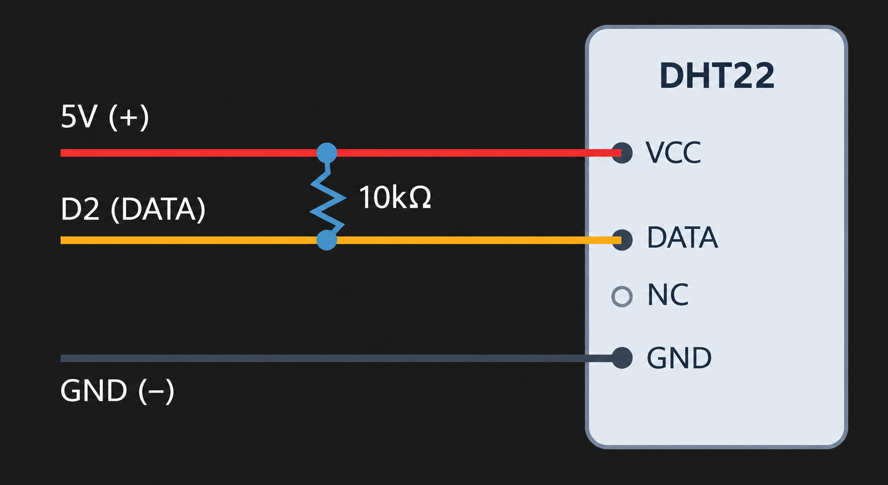

# Arduino 및 ESP8266 기반 IoT 온습도 모니터링 시스템 트러블슈팅

## 프로젝트 개요

Arduino Uno와 DHT22 센서를 이용하여 실내 온도와 습도를 측정하고,
ESP8266을 통해 웹페이지에서 측정값을 실시간으로 확인하는 IoT 시스템 개발 프로젝트입니다.

웹페이지에서 LED 밝기를 조절하는 기능도 구현할 예정입니다.

사용 언어: C++, HTML, CSS, JavaScript (예정)

진행 기간: 2026.11.09 ~ 진행 중

## 온습도 센서 및 LED 제어 기능 챕터 트러블슈팅

### 1. DHT22 풀업 저항의 연결 방식 이해

**현상**
- DHT22 센서 회로 구성 과정에서 풀업 저항을 서로 다른 배선 사이에 연결하는 방법을 알지 못함.

- 풀업·풀다운 저항의 개념은 알고 있었으나 실제 회로에 적용하는 배선 방식에 대한 이해가 부족했음.

**환경**
- Arduino Uno

- DHT22 온습도 센서

- Wokwi 회로 시뮬레이터

**원인 가설**
- 전자회로 및 센서 배선 경험 부족으로 풀업 저항의 실제 연결 구조를 이해하지 못함.

**분석 과정**
- DHT22의 VCC, DATA, GND 핀 구성 확인.

- 풀업 저항의 연결 위치와 회로 구성 방식 검토.

- VCC와 DATA 사이에 저항을 연결하는 방식 학습.

**수정**
- 풀업 저항을 VCC와 DATA 사이에 연결하는 방식으로 배선 구조에 대한 이해 수정.

- 데이터 신호선의 논리 상태를 안정적으로 유지하기 위한 연결 원리 확인.




**검증**
- DHT22의 풀업 저항 연결 위치와 배선 원리를 확인함.

**배운 점**
- 풀업 저항은 전원과 데이터 신호선 사이에 연결하여 신호의 기본 상태를 HIGH로 유지함.

- 회로 구성 시 부품 간 연결뿐 아니라 전원선과 신호선 사이의 연결 관계도 고려해야 함.

---

### 2. `delay()`로 인한 다른 기능의 실행 지연

**현상**
- DHT22 온습도 측정 코드를 먼저 구현한 후 LED 제어 기능을 추가하면서 실행 지연 문제가 발생함.

- 온습도 측정 간격을 위한 `delay()`가 다른 기능의 실행에도 영향을 줌.
```cpp
  // 센서 측정 간격 
  delay(2000);
```
**환경**
- Arduino Uno

- DHT22 온습도 센서

- LED 제어 기능

- VS Code 및 PlatformIO

**원인 가설**
- `delay()`가 지정된 시간 동안 프로그램의 다음 코드 실행을 지연시키기 때문으로 판단함.

**분석 과정**
- 기존 DHT22 온습도 측정 코드의 실행 구조 확인.

- `delay()`가 LED 제어 등 다른 기능의 실행에 미치는 영향 검토.

- `millis()`를 이용한 비차단 방식의 주기 제어 방법 학습.

**수정**
- 온습도 측정 간격에 사용하던 `delay()` 제거.

- `millis()`와 시간 저장 변수를 활용하여 약 2초 간격으로 온습도를 측정하도록 수정.

- 측정 실패 시 실행되던 `delay()`도 제거하고 오류 검사 코드는 유지함.
```cpp
  if (millis() - time_a >= 2000) {
    time_a = millis();
```
**검증**
- 수정한 코드를 VS Code 및 PlatformIO 환경에서 업로드하여 LED 밝기 제어 기능의 동작을 확인함.

- 수정 전후의 응답 시간은 별도로 측정하지 않음.

**배운 점**
- `delay()`는 지정된 시간 동안 다른 코드의 실행도 지연시킬 수 있음.

- 여러 기능을 함께 처리하는 프로그램에서는 `millis()`를 활용한 비차단 방식의 시간 관리가 유용함.

---

### 3. `Serial.parseInt()`의 줄바꿈 문자로 인한 LED 밝기 제어 오류

**현상**
- 수신 데이터에서 정수를 추출하기 위해 사용한 Serial.parseInt()가 남아 있는 줄바꿈 문자로 인해 타임아웃 후 0을 반환하면서 LED가 꺼지는 문제 발생.

**환경**
- Arduino Uno

- LED 및 저항 회로

- 시리얼 통신 기반 LED 밝기 제어

- VS Code 및 PlatformIO

**원인 가설**
- `Serial.parseInt()`가 정수를 읽은 후 남은 줄바꿈 문자로 인해 다시 실행되면서 타임아웃 후 0을 반환하는 것으로 추정함.

**분석 과정**
- 시리얼 모니터에서 LED 밝기값을 입력한 후, 입력하지 않은 `0`이 추가로 출력되고 LED 밝기값이 0으로 변경되어 LED가 꺼지는 현상 확인.

- `Serial.parseInt()`가 정수를 읽은 뒤 남은 줄바꿈 문자로 인해 다시 실행되며, 타임아웃 후 `0`을 반환하는 원인 파악.

- 줄바꿈 설정을 해제하면 숫자의 끝을 구분할 문자가 없어 추가 입력을 기다리다가 기본 약 1초 후 정수를 반환한다는 점 확인.

- 입력 지연을 방지하기 위해 줄바꿈 설정을 유지하고, `Serial.peek()`와 `Serial.read()`로 남은 줄바꿈 문자를 제거하는 방법 검토.

**수정**
- 시리얼 모니터의 줄바꿈 설정을 유지하여 정수 입력 시 발생할 수 있는 타임아웃 지연을 방지함.

- Serial.peek()로 수신 버퍼의 다음 문자가 줄바꿈 문자(\n, \r)인지 확인하고, Serial.read()로 해당 문자를 제거하도록 수정함.

- 줄바꿈 문자가 아닌 경우에만 Serial.parseInt()를 실행하여 불필요한 0 반환으로 LED 밝기값이 변경되는 문제를 방지함.
```cpp
 // 수신 버퍼에 도착해 읽을 준비가 된 데이터의 바이트 수 반환
if (Serial.available() > 0) {
  if (Serial.peek() == '\n' || Serial.peek() == '\r') {
    Serial.read(); // 남아 있는 줄바꿈 문자 제거
  } else {
    LED_light = Serial.parseInt(); // 정수값 추출
    LED_light = constrain(LED_light, 0, 255); // 밝기 범위 제한
    analogWrite(LED_PIN, LED_light); // PWM 밝기 적용
    Serial.println(LED_light); // 적용된 밝기값 반환
  }
 }
```

**검증**
- 수정 후 시리얼 모니터에서 밝기값 입력 시 불필요한 0 출력이 발생하지 않는지 확인.

- 입력한 밝기값이 LED에 정상적으로 적용되고 유지되는지 확인.

**배운 점**
- Serial.parseInt()는 숫자를 찾지 못하면 타임아웃 후 0을 반환할 수 있음을 학습.

- 줄바꿈 문자의 처리 방식에 따라 입력 오류와 응답 지연이 발생할 수 있음을 이해.

- Serial.peek()와 Serial.read()를 활용한 수신 버퍼 처리 방법 학습.
---

### 4. 

**현상**
- a

**환경**
- Arduino Uno

- 

- 

- VS Code 및 PlatformIO


**원인 가설**
- a

**분석 과정**
- a

**수정**
- a

**검증**
- a

**배운 점**
- a
